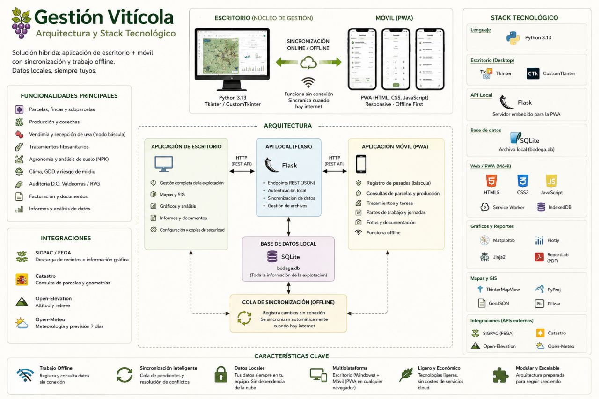

# 🍇 Gestión Vitícola

Tecnología práctica, adaptada al trabajo en el campo.

Aplicación de escritorio + PWA móvil · Datos locales · Trabajo sin conexión.

[Ver la landing page](https://luisrodriguezlopez96.github.io/Vineyard_Public/)

## Arquitectura

La solución combina una aplicación de escritorio que actúa como núcleo de gestión con una PWA móvil para registrar información desde el viñedo. Los datos capturados sin conexión quedan guardados en el dispositivo y se sincronizan con la aplicación de escritorio cuando vuelve la conectividad.

## Funcionalidades

- Gestión de parcelas, subparcelas y fincas con cartografía.
- Producción por campañas y seguimiento de vendimia.
- Registro móvil de pesadas, incluso sin conexión.
- Tratamientos, tareas de campo y agronomía.
- Documentación e informes exportables.
- Integraciones con SIGPAC, Catastro y servicios meteorológicos y de elevación.

## Stack tecnológico

Python, Tkinter/CustomTkinter, SQLite, Flask, HTML, CSS y JavaScript. Visualización e informes con Matplotlib, Plotly, Jinja2 y ReportLab.

## Sobre este repositorio

Este repositorio es una presentación pública del proyecto. No contiene el código fuente de las aplicaciones privadas ni datos reales de la explotación.

[LinkedIn](https://linkedin.com/in/luisrodriguezlopez96) · [GitHub](https://github.com/luisrodriguezlopez96)
