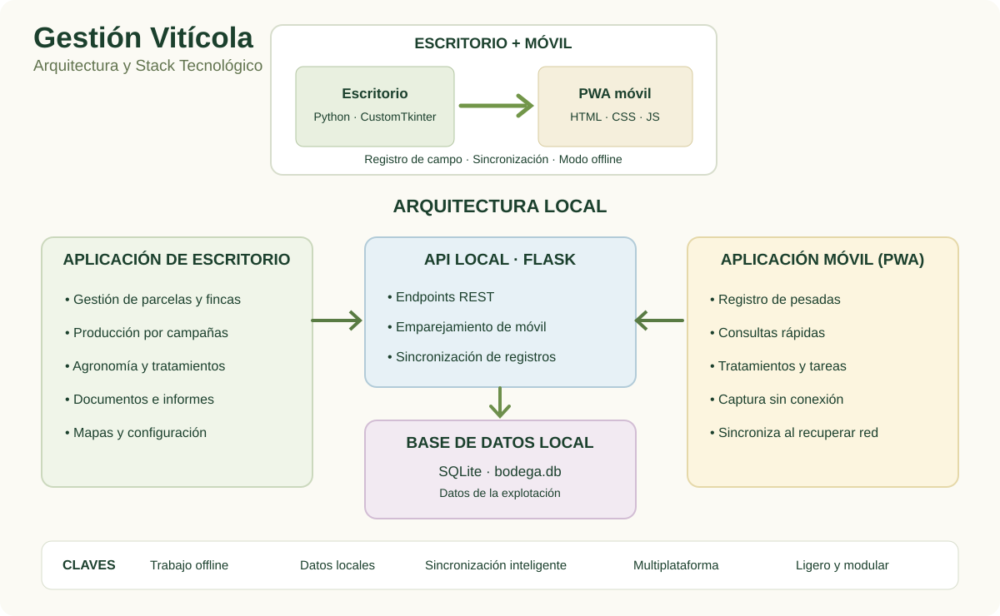

# 🍇 Gestión Vitícola
### Una explotación, siempre a mano

Aplicación de escritorio + PWA móvil · Datos locales · Trabajo sin conexión

[**Ver la landing page →**](https://luisrodriguezlopez96.github.io/Vineyard_Public/)

---

## El proyecto

Gestión Vitícola nació de una necesidad práctica: consultar y registrar información de la explotación cuando el trabajo ocurre en la viña o en la bodega, no solo delante del ordenador.

La solución combina una aplicación de escritorio como núcleo de gestión con una PWA móvil. El sistema prioriza los datos locales y permite registrar información en el móvil cuando no hay conexión, para sincronizarla al recuperar conectividad.

## Arquitectura

  

## Capacidades principales

- **Fincas y cartografía:** parcelas, subparcelas, geometrías e integración con fuentes territoriales.
- **Producción y vendimia:** producción por campaña y registro de pesadas desde el móvil.
- **Agronomía:** análisis de suelo y apoyo a la planificación nutricional.
- **Tratamientos y tareas:** seguimiento del trabajo agronómico y de campo.
- **Documentación:** archivos y facturas vinculados a la gestión de la explotación.
- **Análisis e informes:** comparativas y exportaciones para revisar la evolución.

## Tecnologías

Python · Tkinter / CustomTkinter · SQLite · Flask · HTML · CSS · JavaScript · PWA · Plotly · Matplotlib · ReportLab

## Alcance de este repositorio

Este es un repositorio público de presentación. No distribuye el código fuente de las aplicaciones privadas ni incluye datos reales de la explotación.

**Enlaces:** [Landing page](https://luisrodriguezlopez96.github.io/Vineyard_Public/) · [GitHub](https://github.com/luisrodriguezlopez96) · [LinkedIn](https://linkedin.com/in/luisrodriguezlopez96)
